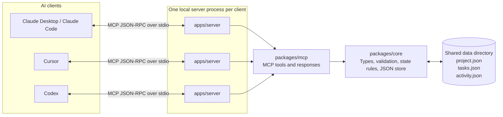
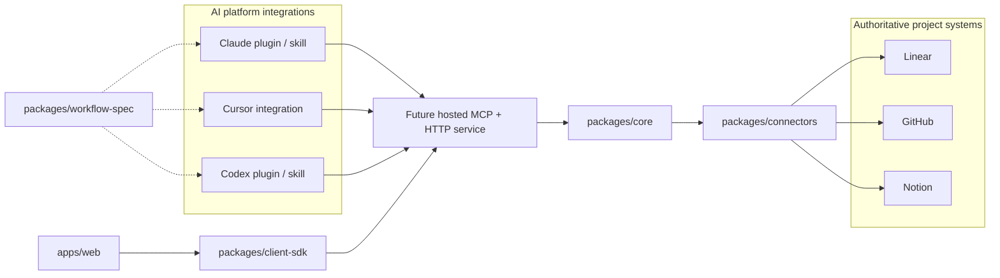

# Project Voyager — Local Cross-AI Continuity POC

Project Voyager is a deliberately small local proof of concept for one question: can one AI client update shared project state and a second AI client continue from it without the user restating the work?

The answer is exposed through one TypeScript MCP server, two tools, stdio transport, and three readable JSON files. There is no hosted service, database, UI, authentication, memory layer, or agent orchestration.

## Current status and handoff summary

The local Phase I continuity proof is implemented. Claude Desktop, Claude Code,
Cursor, and Codex have each connected to the same Voyager project state, read
updates written by another client, and appended attributed handoff activity.

The repository is an npm/TypeScript monorepo. Only `apps/server`,
`packages/core`, and `packages/mcp` contain executable product source today.
The web app, connectors, client SDK, and workflow specification remain
documentation-only boundaries. Client integrations currently contain local
setup templates and guidance, not production plugins.

The POC proves shared project continuity, not general-purpose AI memory. Its
current source of truth is local JSON. Hosted HTTP transport, accounts,
subscriptions, permissions, external project-management connectors, plugins,
and automatic workflow behavior are not implemented.

## Current runtime architecture

Each MCP client starts its own instance of the same compiled server over stdio.
Those server processes achieve continuity by reading and writing the same data
directory.



There is no network listener in the current POC. `stdio` means the client
launches the Node.js process and exchanges MCP JSON-RPC messages through the
process's standard input and output streams. Ordinary logs must therefore not
be written to stdout because they would corrupt the protocol stream.

### Dependency direction

```text
AI client
   │
   ▼
apps/server ──► packages/mcp ──► packages/core ──► local JSON
     │                                  ▲
     └──────────────────────────────────┘
```

- `core` must not depend on MCP, an AI client, HTTP, or a user interface.
- `mcp` translates between MCP tool calls and `core` operations.
- `apps/server` owns process startup, stdio transport, CLI arguments, and
  environment configuration.
- The repository root coordinates workspaces and does not own application
  source. There is intentionally no root `src/` directory.

## Workspace structure

The POC now uses the package boundaries intended for Voyager's next stages while
keeping future components as documentation-only placeholders:

```text
apps/
  server/                 Runnable local MCP server
  web/                    Reserved continuity cockpit
packages/
  core/                   Shared state types, validation, and JSON store
  mcp/                    MCP schemas, tools, and response formatting
  connectors/             Reserved authoritative source adapters
  client-sdk/             Reserved typed application client
  workflow-spec/          Reserved platform-neutral workflow guidance
integrations/
  claude-code-plugin/     Claude Code template; future plugin boundary
  codex-plugin/           Codex template; future plugin boundary
  cursor/                 Cursor template; future integration boundary
  manual-mcp/             VS Code and Claude Desktop templates/guidance
data/                     Live local POC state
tests/                    Unit tests and immutable fixtures
scripts/                  Build hygiene, local setup, and MCP smoke test
```

The runnable compiled entry point is `apps/server/dist/index.js`. Each package
owns its own `dist/` output, and generated files are not source-controlled.

### Package and directory responsibilities

| Location | Current responsibility |
| --- | --- |
| `apps/server` | Runnable local MCP process and server configuration |
| `apps/web` | Placeholder for a future continuity cockpit |
| `packages/core` | Transport-independent types, Zod schemas, state rules, context summaries, and JSON persistence |
| `packages/mcp` | MCP tool schemas, tool registration, annotations, text formatting, and structured responses |
| `packages/connectors` | Placeholder for adapters to authoritative systems such as Linear, GitHub, Notion, or Jira |
| `packages/client-sdk` | Placeholder for a typed client used by applications to call a future hosted Voyager API |
| `packages/workflow-spec` | Placeholder for platform-neutral guidance describing when AI clients should read context, record handoffs, preserve provenance, and request approval |
| `integrations` | Platform-specific packaging: Claude and Codex plugins/skills, Cursor setup, and manual MCP configuration |
| `data` | Mutable live POC state shared by configured local clients |
| `tests/fixtures/data` | Immutable seed state used by automated tests |
| `tests` | Core behavior, response formatting, and server configuration tests |
| `scripts` | Generated-output cleanup, local client setup, and end-to-end two-client MCP smoke test |

Reusable integration source and templates are committed under `integrations/`.
Root `.claude`, `.codex`, `.cursor`, and `.vscode` directories are ignored
generated developer state and are not the source of client skills or plugins.

`integrations` and `connectors` are intentionally different. Integrations
connect AI clients to Voyager; connectors connect Voyager to external systems
that own project data.

### Implemented source files

```text
apps/server/src/
  config.ts              Resolve --data-dir and VOYAGER_* configuration
  index.ts               Compose the store, MCP server, and stdio transport

packages/core/src/
  types.ts               Shared project, task, activity, input, and output types
  schemas.ts             Runtime validation for files and operations
  store.ts               Read, summarize, update, queue, and persist JSON state
  index.ts               Public package exports

packages/mcp/src/
  schemas.ts             MCP-facing schema adaptation
  server.ts              Tool registration and portable response formatting
  index.ts               Public package exports
```

Each real workspace owns its own `src/` and compiled `dist/`. Multiple `dist/`
directories are expected because TypeScript project references compile each
workspace as a separate package with JavaScript, declarations, source maps, and
incremental build metadata.

## How operations work

### Read path: `get_current_context`

1. An AI client calls the MCP tool through its stdio connection.
2. `packages/mcp` validates the optional MCP arguments and calls the core store.
3. `VoyagerStore` waits for any queued mutation in that process to finish.
4. The store reads and validates all three JSON files.
5. It validates the optional/configured project ID, orders activity newest
   first, applies `recentActivityLimit`, and generates a compact summary.
6. MCP returns both portable text in `content` and typed data in
   `structuredContent`. The text also includes every returned activity entry
   because some clients do not reliably expose structured content to the model.

### Write path: `update_task`

1. MCP strictly validates `taskId`, `status`, `note`, and `actor`.
2. The core store serializes mutations within that server process.
3. It reloads and validates the project, task, and activity files.
4. It preserves unknown task fields, changes only status/timestamp, and creates
   an attributed activity entry. Same-status updates are allowed as progress
   notes.
5. Updated task and activity JSON are first written to unique temporary files.
6. The temporary files are renamed into place; an ordinary second-file failure
   triggers a best-effort rollback of the task file.
7. The result is returned as readable text and structured data.

## Prerequisites

- Node.js 20.19+ on the Node 20 line, Node.js 22.12+ on the Node 22 line, or Node.js 24+
- npm
- Two local MCP-compatible AI clients for the manual acceptance test

The implementation uses the current officially recommended stable SDK line as of July 12, 2026: `@modelcontextprotocol/sdk` 1.29.0. The official v2 split packages are still prerelease, so this POC intentionally uses the stable v1 package and its current `registerTool` APIs.

## Local contributor setup

From a fresh clone:

```powershell
npm ci
npm run setup:local
npm test
npm run smoke
```

These commands work in PowerShell, Command Prompt, macOS, and Linux when Node.js
and npm are installed and available on `PATH`.

`setup:local` builds `apps/server/dist/index.js`, resolves paths for the current
clone and Node.js installation, then creates or refreshes the ignored local MCP
configuration described below. Run it again after moving the repository,
changing Node.js installations, or changing an integration template.

Useful individual commands:

| Command | Purpose |
| --- | --- |
| `npm run build` | Clean and compile all implemented TypeScript workspaces |
| `npm run setup:local` | Build and generate local MCP client configuration |
| `npm run dev` | Run the TypeScript MCP entry point through `tsx` |
| `npm start` | Run the compiled stdio MCP server directly |
| `npm test` | Build and run the Vitest suite |
| `npm run smoke` | Build and run the isolated two-client MCP continuity test |

For development without a separate build:

```powershell
npm run dev
```

`npm start` and `npm run dev` are stdio MCP processes. They normally appear to wait silently because an MCP client must send JSON-RPC messages on stdin. Normal server output is never written to stdout; fatal diagnostics go to stderr.

## MCP tools

The server exposes exactly two tools:

- `get_current_context` reads the project, current milestone, tasks, blockers, recent activity, a generated summary, and a fresh timestamp. Optional inputs are `projectId` and `recentActivityLimit` (0–100, newest first).
- `update_task` accepts `taskId`, `status`, `note`, and `actor`; updates the task timestamp and status; and appends an attributed activity entry. Valid statuses are `backlog`, `ready`, `in_progress`, `blocked`, and `done`.

Successful calls return both model-readable text in `content` and machine-readable data in `structuredContent`. Expected failures are returned as client-readable MCP tool errors.

## Local JSON state

- `data/project.json` contains the single `voyager-poc` project, current milestone, and project blockers.
- `data/tasks.json` contains the three seeded POC tasks.
- `data/activity.json` contains the append-only-by-convention attributed activity history.

By default, the server resolves `data/` beside the project regardless of the MCP host's working directory. Set `VOYAGER_DATA_DIR` to a directory containing the same three files to use an isolated copy. Relative configured paths resolve from the server process's working directory. The equivalent `--data-dir <path>` command-line option takes precedence over `VOYAGER_DATA_DIR` and is useful for future packaged installations.

Set `VOYAGER_PROJECT_ID` to the ID expected in `project.json` (currently `voyager-poc`). The server validates this guard before reads and writes, preventing a client configuration from silently using another project's data directory. Both AI clients participating in a handoff must point at the same data directory and expected project ID.

Writes are formatted JSON. Each replacement is staged to a unique temporary file in the destination directory and renamed; a normal second-file failure triggers a best-effort rollback of the first file.

## Generated MCP client configuration

Run the setup command from the repository root:

```powershell
npm run setup:local
```

It produces the following local files:

| Client | Generated file | Next step |
| --- | --- | --- |
| Claude Code | `.mcp.json` | Launch Claude Code in the repository, approve the project server, then inspect `/mcp` |
| Cursor | `.cursor/mcp.json` | Open the repository in Cursor and enable or reconnect `project-voyager` |
| VS Code | `.vscode/mcp.json` | Open the repository and start `project-voyager` from `MCP: List Servers` |
| Codex app, CLI, and IDE | `.codex/config.toml` | Trust the repository, restart/reconnect Codex, then inspect MCP settings, `/mcp`, or `codex mcp list` |
| Claude Desktop | `.claude/claude-desktop-mcp.json` | Add/merge the generated entry in Claude Desktop's MCP settings, then restart Desktop |

JSON configuration is merged without removing unrelated MCP servers. The setup
script manages only the marked Project Voyager block inside Codex's TOML file.
Claude Desktop remains manual because its configuration is user-level and the
repository script intentionally does not modify files outside the clone.

All generated clients use the same values:

- compiled server: `apps/server/dist/index.js`
- shared state: `data/`
- expected project ID: `voyager-poc`

Every client launches a separate stdio process, but all processes read and
write the same state directory. Restart or reconnect a client after rebuilding
so it launches the new compiled code.

### Manual fallback configuration

If `setup:local` cannot be used, replace the placeholders and add this entry to
a JSON-based MCP client:

```json
{
  "mcpServers": {
    "project-voyager": {
      "command": "node",
      "args": ["/ABSOLUTE/PATH/project-voyager/apps/server/dist/index.js"],
      "env": {
        "VOYAGER_DATA_DIR": "/ABSOLUTE/PATH/project-voyager-poc/data",
        "VOYAGER_PROJECT_ID": "voyager-poc"
      }
    }
  }
}
```

The `env` entry is optional when using the repository's default `data/`
directory, but making it explicit helps confirm every client shares exactly the
same files.

Windows JSON paths must escape backslashes:

```json
{
  "mcpServers": {
    "project-voyager": {
      "command": "node",
      "args": ["C:\\ABSOLUTE\\PATH\\project-voyager\\apps\\server\\dist\\index.js"],
      "env": {
        "VOYAGER_DATA_DIR": "C:\\ABSOLUTE\\PATH\\project-voyager-poc\\data",
        "VOYAGER_PROJECT_ID": "voyager-poc"
      }
    }
  }
}
```

A source-running development fallback is:

```json
{
  "mcpServers": {
    "project-voyager-dev": {
      "command": "node",
      "args": [
        "/ABSOLUTE/PATH/project-voyager/node_modules/tsx/dist/cli.mjs",
        "/ABSOLUTE/PATH/project-voyager/apps/server/src/index.ts"
      ],
      "env": {
        "VOYAGER_DATA_DIR": "/ABSOLUTE/PATH/project-voyager-poc/data",
        "VOYAGER_PROJECT_ID": "voyager-poc"
      }
    }
  }
}
```

The absolute local `tsx` path avoids depending on the MCP host's working
directory or downloading a package at launch. Run `npm ci` first. The generated
compiled-Node configuration remains the recommended acceptance-test setup.

## Distribution readiness

Generated `.mcp.json`, `.cursor/mcp.json`, `.vscode/mcp.json`,
`.codex/config.toml`, and `.claude/claude-desktop-mcp.json` remain development
configuration for this checkout and are ignored by Git. Their committed
templates live under `integrations/`. Voyager is not published or installed
globally yet.

The server now exposes stable executable names, `project-voyager-mcp` and the backwards-compatible `project-voyager`, through the server package. Its storage can be selected independently with `--data-dir` or `VOYAGER_DATA_DIR`, and `VOYAGER_PROJECT_ID` guards against cross-project mistakes. These are preparation for a later npm package, native executable, client plugin, or hosted server; they do not register Voyager globally by themselves.

The intended production default is one user-level installation with a distinct data directory and project ID per workspace. Client-specific installers and automatic workspace discovery are intentionally deferred until the MCP tools and persisted-data model are stable.

## Intended future architecture — not implemented

The package boundaries reserve a path from the local proof to a hosted Phase I
product without requiring the POC to pretend those capabilities already exist.



In that direction, plugins and skills are client-specific behavior and
distribution layers, while all clients share the same hosted Voyager service.
The client SDK provides typed HTTP access for normal application code. The
workflow specification prevents each client plugin from inventing different
continuity behavior. Connectors read or propose writes against authoritative
project-management systems. None of these future components should be
implemented until product testing establishes the exact contracts they need.

## Programmatic smoke test

```powershell
npm run smoke
```

The smoke script builds the server, copies the seed JSON into a temporary directory, and uses the official SDK client over stdio. Client A reads and updates `task-001`, disconnects, and then a fresh Client B/server process reads the same directory. It verifies the exact tool list, structured responses, error responses, actor/note/timestamp continuity, disk persistence, valid JSON, and temporary-file cleanup. It never changes the checked-in seed state.

At the current handoff point, `npm test` passes 21 tests across three test
files, and `npm run smoke` passes the two-client continuity scenario. These
counts describe the current repository and should be updated when tests change.

## Exact two-client acceptance test

Configure both clients with the same built server and data directory, then follow this script.

1. In Client A, ask: **“Read the current Voyager project context.”** Confirm it calls `get_current_context`.
2. In Client A, ask: **“Start task-001. Record that implementation has begun, and attribute the update to client-a.”** Confirm it calls `update_task` with:

   ```json
   {
     "taskId": "task-001",
     "status": "in_progress",
     "note": "Implementation has begun.",
     "actor": "client-a"
   }
   ```

3. Close or stop Client A's session. Do not tell Client B what Client A changed.
4. In Client B, ask: **“Read the current Voyager project context and tell me what changed most recently.”** Confirm it calls `get_current_context`.
5. Verify Client B sees `task-001` as `in_progress`, the note “Implementation has begun.”, actor `client-a`, and the activity timestamp.
6. In Client B, ask: **“Continue the current task based on the shared state.”** The handoff succeeds if it continues from the stored update without you restating it.

For repeatable manual tests, copy `data/` first and point both clients' `VOYAGER_DATA_DIR` at that copy. If you test against the checked-in files, restore `data/tasks.json` and `data/activity.json` from source control afterward; there is intentionally no reset tool in this POC.

## Known POC limitations

- One project per configured data directory; automatic workspace discovery and data-directory provisioning are not implemented yet.
- Actor attribution is supplied by the caller and is not authenticated.
- JSON files are appropriate for this sequential handoff experiment, not high-write concurrency.
- Writes are serialized within one server process. Separate client-spawned processes can race if they update at the same instant; there is no cross-process lock.
- Per-file rename protects against partially written JSON, but the task/activity pair is not a crash-proof database transaction. Rollback is best effort for ordinary write failures.
- The pinned SDK/Zod combination uses a small schema compatibility hint so an MCP call may omit the optional `arguments` object while still advertising its fields. Re-run the smoke test before upgrading either package.
- No permissions, hosted deployment, database, UI, integrations, search, telemetry, backups, notifications, background work, or autonomous agents.
- Client trust and approval prompts vary by MCP host. Claude Desktop still
  requires a manual user-level add/import step in this local POC.

## Guidance for the next implementation agent

- Read this README and `md/Project_Voyager_Local_POC_Implementation_Brief.md`
  before changing the POC.
- Keep `packages/core` transport-independent and preserve the dependency
  direction described above.
- Do not add source under the repository root; add it to the application or
  package that owns it.
- Treat `data/` as mutable manual-test state and `tests/fixtures/data` as the
  deterministic automated-test seed.
- Preserve the built MCP entry point at `apps/server/dist/index.js` unless all
  configured clients are intentionally migrated.
- After changing compiled server code, rebuild and reconnect/restart each MCP
  client so it starts a process containing the new build.
- Run `npm run setup:local` after cloning or when local development MCP
  configuration needs to be regenerated.
- Run both `npm test` and `npm run smoke` before handing off changes.
- Do not add hosted infrastructure, a database, authentication, billing,
  connectors, plugins, autonomous updates, or a generalized memory layer merely
  because their future package boundaries exist.
